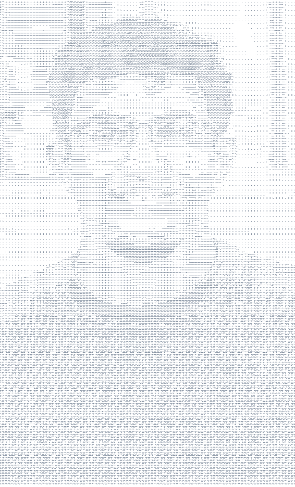

# Krish Patel

I'm interested in **machine learning, algorithms, and computational neuroscience**—especially how models learn useful representations from complex data, and how we can understand what those representations actually capture.

My research explores **neural representations of speech**, including how acoustic models and experimental baselines shape conclusions about phonetic encoding. I'm also interested in **model compression and parameter-efficient representations**, with an emphasis on preserving model behavior while reducing complexity.

I enjoy work that combines mathematical reasoning, careful experiments, and practical implementation.

### Areas of interest

- **Machine learning:** representation learning, model efficiency, and interpretability
- **Computational neuroscience:** neural encoding, speech perception, and auditory processing
- **Algorithms:** optimization, graph algorithms, and computational problem solving

### Tools and languages

**Languages:** Python · C++ · C · Java · R · JavaScript · Swift  
**ML and scientific computing:** PyTorch · scikit-learn · NumPy · pandas · Matplotlib · TensorFlow

### About this portrait

The image on the right is a crop of an ASCII-art portrait made entirely from text characters. The [complete ASCII version](./assets/ascii-portrait.txt) is also available in this repository.

<!-- Add links to publications, a CV, LinkedIn, or selected projects here when ready. -->
